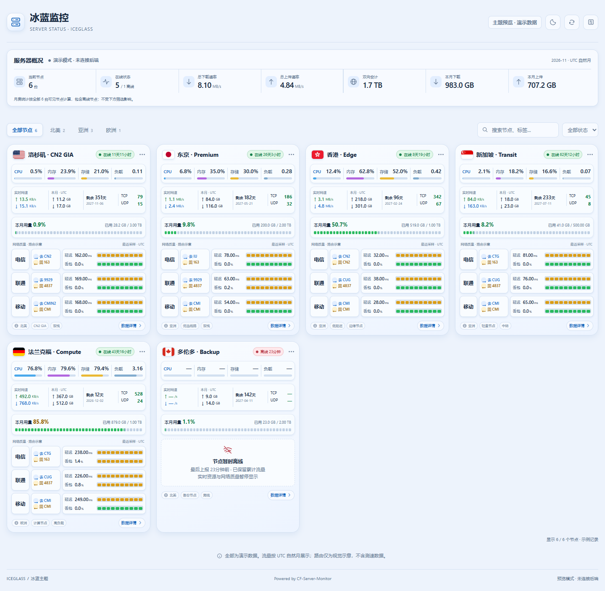
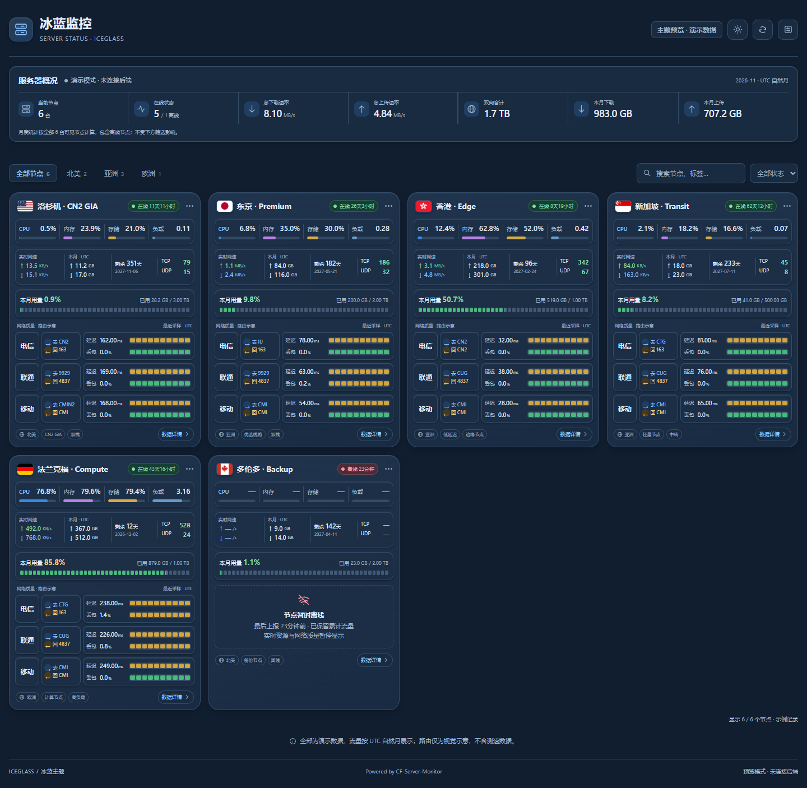
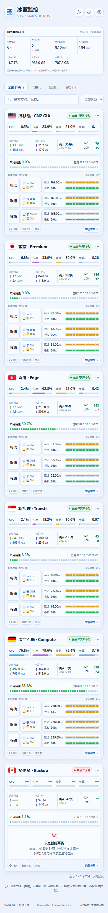
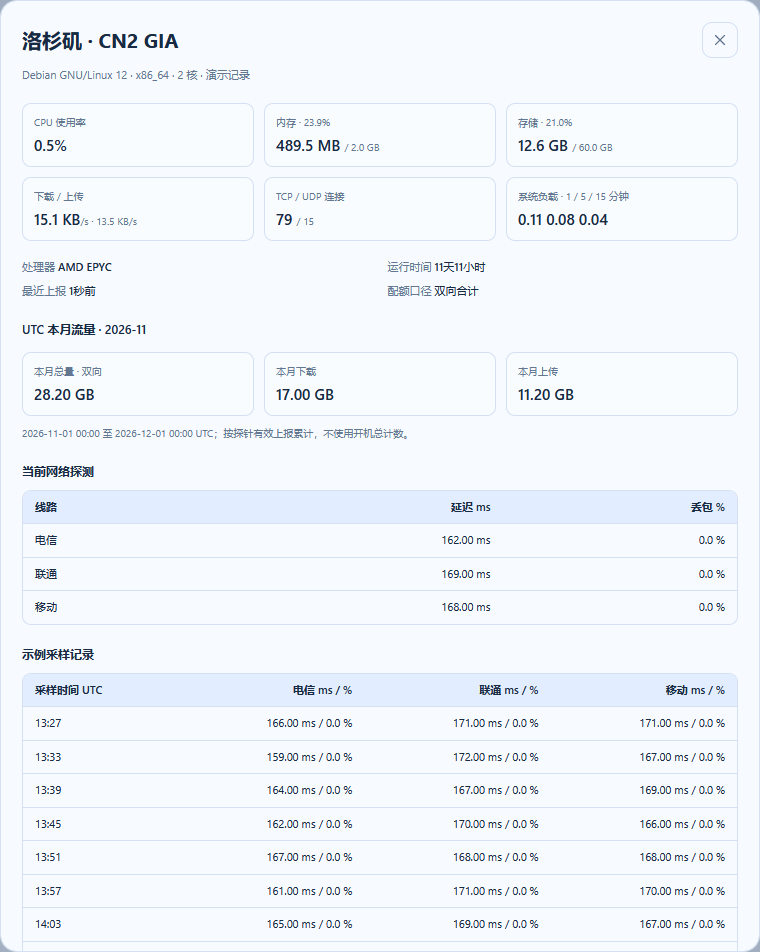

# Iceglass 冰蓝主题

为 [CF-Server-Monitor](https://github.com/huilang-me/CF-Server-Monitor) 制作的轻量级第三方主题。浅冰蓝卡片、深色模式、桌面四列节点、UTC 月度流量，以及分行显示的延迟和丢包记录。

**这是前台主题，不是独立监控后端。** 正式使用需要已部署的 CF-Server-Monitor 和正常上报的探针。截图及本地演示均为示例数据，不包含真实服务器信息。

## 样式预览

### 桌面 · 浅色



### 桌面 · 深色



<details>
<summary>查看手机样式</summary>

手机端节点自动变为单列，七项总览指标在同一个框内分两行展示。后台入口位于右上角按钮组最后，只显示图标。



</details>

<details>
<summary>查看节点详情样式</summary>



详情可以使用右上角关闭图标、Escape 键或点击遮罩关闭。

</details>

> 预览中的地区、节点名称、分组、标签和路由均为示例。主题不会自动识别 CN2 GIA 等线路，标签也不能作为线路认证。没有分运营商测速功能或虚构的 Mbps 测速结果。

## 功能

- **同框总览**：当前节点、在线状态、总下载速率、总上传速率、双向月流量、本月下载、本月上传。桌面单行显示七项指标。
- **响应式节点卡片**：页面宽度至少 1280px 时每行四张；861–1279px 每行两张；860px 及以下每行一张。
- **实时资源**：CPU、内存、存储、负载、上传/下载网速及 TCP/UDP 数量。
- **UTC 月度流量**：每台服务器显示本月上传和下载；全站汇总包含离线节点，不随搜索和分组筛选改变。
- **网络质量**：每个探测节点上方显示延迟，下方显示丢包；等宽采样格铺满轨道。零值、超时和缺失值分别处理。
- **筛选与详情**：支持分组、搜索、在线状态筛选，以及节点详情和采样数据表。
- **浅色 / 深色**：正式模式读取后台首选主题，支持手动切换并在当前浏览器记住选择。
- **后台入口**：右上角最后一个图标链接到 `/admin#/admin`，仍由原项目默认主题接管后台。
- **无前端运行依赖**：原生 HTML、CSS、JavaScript，不需要构建或 CDN。

## 一、先在本地看效果

### 直接打开

下载本仓库后，使用现代浏览器打开：

```text
demo/index.html
```

这是一个完整的单文件演示，样式、脚本和示例图标均已内联。不会请求监控 API，不需要后端，也不需要安装依赖。演示页点击后台图标只显示说明，不会真的进入管理后台。

### 使用本机 HTTP 预览

安装 Node.js 20 或以上版本，在仓库根目录运行：

```sh
npm run dev
```

然后打开：

```text
http://127.0.0.1:4178/
```

也可以不使用 npm，直接运行：

```sh
node scripts/preview.mjs
```

预览服务仅监听 `127.0.0.1`。按 `Ctrl+C` 停止。如果端口已占用，可用 `PORT` 环境变量指定其他端口。

**不要把 `demo/index.html` 当作正式主题使用。** 它始终展示演示数据；正式主题入口是 `theme/index.html`。

## 二、接入 CF-Server-Monitor

### 前置条件

1. 已部署 CF-Server-Monitor，探针正常上报。
2. 所用版本支持第三方主题 GitHub tree 地址。
3. 主题目录中的 `index.html` 和 `assets/` 能被 Worker 访问。使用 GitHub 主题地址时通常需要公开仓库，当前主题不提供私有仓库访问凭证。

### 在后台设置第三方主题

1. 打开现有监控站点的 `/admin#/admin` 并登录。
2. 进入后台的外观设置 / 主题页面，找到第三方主题 GitHub tree 地址输入框。
3. 填入**指向本仓库 `theme/` 目录**的地址，格式如下：

   ```text
   https://github.com/famintt/cfsm-theme-iceglass/tree/main/theme
   ```

   以上地址指向本仓库 `main` 分支下的 `theme/` 目录，可直接复制到后台。若自行 Fork 或更换分支，请相应修改账号、仓库名和分支名。不要填写账号主页、仓库首页、`blob/.../index.html` 或 `demo/` 目录。

4. 建议先使用后台的预览功能确认界面和数据正常，再应用主题。
5. 回到监控站点首页检查节点、流量和网络质量。

CF-Server-Monitor 会读取该主题目录的 `index.html` 和 `assets/`，在**监控站点同域**提供页面和静态资源。管理后台无需替换。

### 接入方式与资源路径

正式入口保留以下配置即可：

```html
<meta name="apiBase" content="">
```

空值代表当前页面同源。此版本只支持**一个同源后端**，会明确拒绝跨源、多后端或带额外路径的 `apiBase`，避免把现有凭证转发到其他站点。

- 旗帜读取原项目的 `/flags/<code>.svg`。
- 系统图标读取原项目的 `/os-icons/<filename>`。
- 站点标题、首选主题和显示开关读取后台配置。
- 正式模式不读取 `config.json`，也不需要填写 API Secret。

仅把 `theme/` 发布到 GitHub Pages 或其他独立域名，并不能直接连接远端监控后端；本版本未实现这种跨源部署。

### 私有站点或人机验证

如果接口提示需要验证，使用提示中的链接前往默认后台 `/admin#/admin` 登录或完成验证，然后回到首页刷新。主题不另写登录页或 Turnstile 页面，也不绕过原站点权限。

## 三、UTC 月度流量说明

### 什么数据会计入

主题使用探针返回的以下字节计数：

```text
net_rx_monthly  本周期下载
net_tx_monthly  本周期上传
```

只有同时满足以下条件，才会将其作为 UTC 自然月流量：

- 服务器返回 `reset_day = 1`，即探针按每月 1 号 UTC 重置。
- 最近上报时间属于当前 UTC 月份且不是异常未来时间。
- 对应的上传、下载计数有效且非负；`0` 是有效值。

UTC 自然月范围为每月 1 日 `00:00:00 UTC` 起，到下月 1 日 `00:00:00 UTC` 前。例如 11 月对应 `[11 月 1 日 00:00 UTC, 12 月 1 日 00:00 UTC)`，不按浏览器本地时区切月。

### 各处数字的含义

| 位置 | 口径 |
| --- | --- |
| 总览“双向合计” | 可确认月度口径节点的本月上传 + 本月下载 |
| 总览“本月下载 / 本月上传” | 上述节点分别相加，包含离线节点 |
| 卡片“本月 · UTC” | 当前节点的本月上传 / 下载，不再显示开机以来流量 |
| 卡片“本月用量”百分比 | 按该节点 `traffic_calc_type` 计算的月用量 / 流量配额 |

配额支持原项目的 `total`（双向）、`dl`（下载）、`ul`（上传）、`max`（取较大值）。**全站双向合计始终为上传 + 下载**，不会因为某个节点只按上传计费而少计下载。

### 不完整数据如何处理

如果重置日不是 1 号、重置日未返回、本月没有上报或计数缺失：

- 卡片提示 UTC 本月流量不可用，并说明原因。
- 该节点不会被错误地混入 UTC 月合计。
- 总览底部显示已计入的节点数量及排除说明。

可在原项目后台将对应服务器的流量重置日设为 1，并确认探针配置已实际生效。**主题本身不会修改后台或探针设置，也无法恢复修改前、重装前或缺失的历史流量。** 月中安装、计数重置、手动校正或探针长期未上报，都可能使当月统计不完整；数据应以探针有效上报为准，不应作为精确账单凭证。

## 四、卡片字段说明

| 字段 | 含义 |
| --- | --- |
| 实时网速 `↑ / ↓` | 最近一次上报的上传 / 下载速度，按 B/s 换算显示，不是 Mbps 带宽测速 |
| `TCP` | 探针上报的 TCP 连接数；不等于访问人数 |
| `UDP` | 探针上报的 UDP 套接字 / 端点数量；UDP 没有 TCP 那样的已建立连接 |
| 延迟 `ms` | 到探测节点的往返延迟，`null` 单独显示为超时 |
| 丢包 `%` | 到探测节点的丢包比例，`0%` 正常显示，不当成缺失 |
| 底部分组 | 优先读取 `server_group`，未设置时回退到地区或“未分组” |
| 底部标签 | 读取后台填写的 `tags`，当前卡片最多显示两个，不是自动线路识别 |

正式模式不会伪造去回程路由：公开字段没有路由时显示“路由未提供”。演示中的 CN2、9929 等路由仅为排版示例，不是真实 traceroute 结果。

## 五、目录与开发

```text
.
├── README.md
├── LICENSE
├── UPSTREAM-LICENSE.txt
├── package.json
├── theme/                 # 正式主题目录，后台主题地址应指向这里
│   ├── index.html
│   └── assets/
│       ├── app.js         # 界面与交互
│       ├── client.js      # 只读 HTTP / WebSocket 接入
│       ├── demo.js        # 明确启用演示模式时才使用的示例数据
│       ├── model.js       # 单位换算、UTC 月流量等数据逻辑
│       └── theme.css      # 深浅配色、响应式卡片和总览样式
├── demo/
│   └── index.html         # 自包含演示快照，不用作正式入口
├── docs/screenshots/      # README 样式截图
├── scripts/
│   └── preview.mjs        # 本机演示 HTTP 服务
└── tests/
    ├── client.test.mjs
    └── model.test.mjs
```

### 运行测试

无需安装依赖：

```sh
npm test
```

测试覆盖只读客户端、增量推送、页面可见性、连接超时、错误处理、输入转义、单位换算及 UTC 月界等。当前版本为 **82 项通过**。

### 修改样式

修改 `theme/assets/theme.css`，修改交互则编辑 `theme/assets/app.js`。生产主题不需要构建。`demo/index.html` 和截图是发布快照，**修改源码后不会自动更新**，需要同步维护，不要用旧演示替代源码验证。

## 已知限制与验证范围

- 这是第三方前台，不包含监控后端、探针安装器或管理后台。
- 仅支持单个同源后端；不支持跨源聚合和 GitHub Pages 直接连接远程后端。
- 当前界面以中文为主，没有额外实现完整多语言切换。
- 详情展示实时指标及已取得的列表采样快照，不提供完整历史趋势图或补齐缺失采样。
- WebSocket 不可用时使用定时刷新；隐藏页面暂停连接，达到站点配置的连接时限后需要手动恢复。
- 超过 500 台服务器时客户端明确使用轮询，不截断节点冒充全量订阅。
- 正式配置或接口失败时显示错误，不会静默回退到演示数据。
- 依据 CF-Server-Monitor 提交 `1be24f0eabdcc2d06c215c45258382b02e438b49` 的公开主题协议开发；未保证所有旧版本兼容。
- 已完成桌面 / 手机、深浅色、筛选、详情关闭及本地模拟后端检查。**尚未在真实 Cloudflare 部署环境进行端到端验收**，安装后应先使用管理员预览确认。

## 许可证与致谢

主题采用 [MIT License](LICENSE)。

感谢 [CF-Server-Monitor](https://github.com/huilang-me/CF-Server-Monitor) 提供监控后端和第三方主题接口。页面保留 `Powered by CF-Server-Monitor` 链接。演示内嵌的旗帜与系统图标来自参照项目的默认静态资源，上游许可证保留于 [UPSTREAM-LICENSE.txt](UPSTREAM-LICENSE.txt)。
